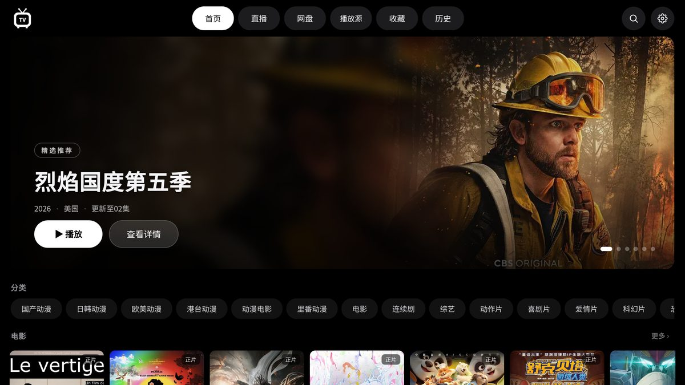
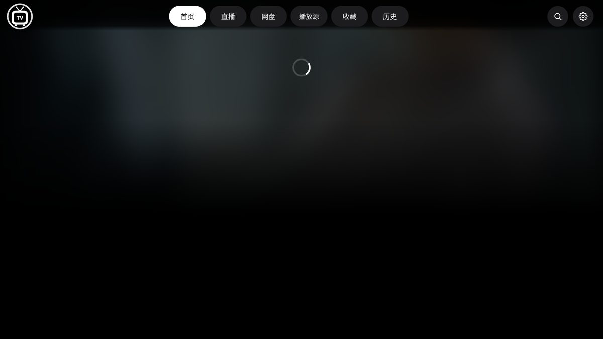
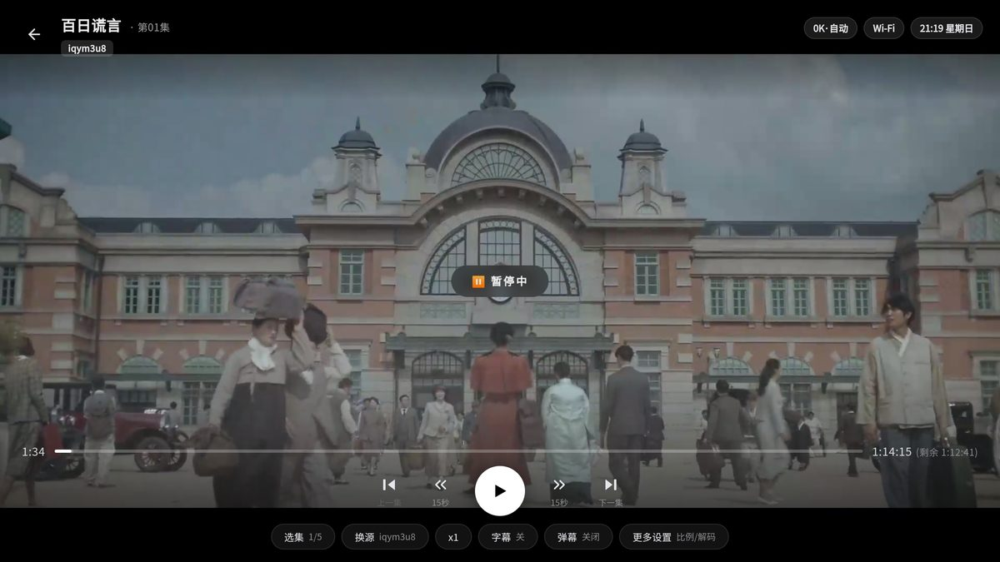
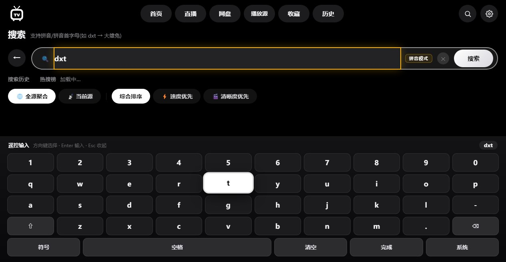

<div align="center">

# 📺 AMUTV — 类 TVBox 影视 TV(纯 Web)

     

一个纯网页版的「影视TV」,界面与交互对标电视盒子的 TVBox / 影视仓,**零 npm 依赖,`node server.js` 一条命令即跑**。


## 📸 截图

| 首页 · Hero 精选轮播 | 详情 · 三源评分与演职员 |
|---|---|
|  |  |

| 播放器 · 双层控制与暂停提示 | 遥控输入 · 到输入框自动弹键盘 |
|---|---|
|  |  |

</div>

---

## ✨ 功能特性

### 🖥️ 大屏交互
- **纯黑海报墙主题**(Apple TV 风格):胶囊导航、白色焦点环,适配遥控器与鼠标双操作;全新**小电视 App 图标**
- **首页 Hero 精选轮播**:海报氛围背景 + 自动轮播,继续观看(带进度条)/收藏/分类内容行/最近更新
- **遥控器式导航**:方向键在卡片间移动焦点,Enter 确认,Esc/Backspace 返回;点击画面=暂停,双击=全屏
- **遥控输入自动弹键盘**:方向键移到输入框自动弹出屏幕软键盘(字母/数字/符号三组,方向键选字、Enter 输入、⌫ 删除、Esc 收起、完成直接搜索),电视端可一键切系统输入法
- **设置页 TV 分区卡片**:SVG 图标体系 + 样式化开关行 + **数据与备份**(一键导出/导入全部配置、清缓存、恢复默认)

### 🗄️ 内容源
- **多仓 / 接口订阅**:URL 订阅或粘贴 TVBox 配置 JSON(单仓 `sites` / 多仓 `urls`·`storeHouse`),`clan://` 按仓库基址解析,爬虫类(type 3)源自动跳过,支持刷新/退订/源连通性测试(绿/红状态点)
- **多源全网搜索**:并发池搜索全部源,按源分组展示耗时;支持**拼音/拼音首字母**(`dxt` → 大雄兔);结果可按**速度优先 / 清晰度优先**排序
- **手动/自动换源**:播放页「换源」面板列出其他源同名影片;播放失败或**卡顿超15秒**自动换源(最多3次,可关)
- **详情页全信息面板**:**烂番茄爆米花指数 · IMDb · 豆瓣**三源影评评分 + 演员定妆圆头像(饰角色)+ 详细剧情梗概(自动刮削,按片缓存)
- **分类多重筛选器**:分类页支持按 **类型(科幻/动作…)**、**地区(内地/欧美/日韩…)**、**年份(2026/2025…)** 三维复合筛选 —— 维度内多选 OR、维度间 AND,筛选项从已加载数据自动生成;激活筛选时后台自动补全分页(限 400 部)以充实结果

### 📺 直播 IPTV
- m3u / txt(含 `#genre#`、`$装饰后缀`)双格式解析,**同名频道多线路合并**容灾
- EPG 节目单(正在播/接下来,当天缓存),分组/频道懒加载,多源管理
- 播放卡壳自动切线路看门狗(45秒未出画自动换下一线路)
- **拉取多路兜底**:内置源 jsDelivr/ghproxy/gh-proxy 多镜像自动回退;传输通道按环境自适应 —— 浏览器走本地 `/proxy/`,安卓 App 走本机 MiniServer 代理 / Java 桥 / 直连,源站挂了就换下一条路

### ▶️ 播放器
- **双层控制**(杜绝误触):顶栏轻量状态层(时钟星期/实时网速/画质·HDR 徽章,纯展示)+ 底部深度配置层(全带实时值)
- **核心播放行**:上一集(第N集)/±15秒/中央播放键/下一集(第N集);**进度条擦洗悬浮缩略图预览**(拖动时实时显示目标画面)
- **扩展功能行带状态值**:选集 12/36 · 换源名 · 倍速 · 字幕轨 · 音轨 · 弹幕(开启·透明度)一键直达
- **选集带图卡片墙**:每集自动取帧缩略图 + 正在播/已看标记;暂停中央轻提示、剩余时间显示
- HLS(多码率画质锁档)/ MP4 直连,解码内核与硬解/软解一键热切
- **倍速 0.5~3x、画面比例、画面缩放、在线字幕**(SubHD 自动下载,偏移微调)、**弹幕**(B站 XML 渲染 + 弹弹play 接口)
- 片头/片尾标记与**自动跳过**,断点续播,卡顿三级看门狗(修复→切软解→换源),m3u8 广告切片双层过滤

### ☁️ 影视库扩展
- **网盘页卡片化**:驱动 SVG 卡片行(本地U盘/云盘/挂载盘),**列表视频行自动缩略图**,全部/视频/其他筛选 + 容量统计
- **网盘直连**:**Alist**(302 原画直链)、**WebDAV**、**SMB**(Windows 直读 UNC)、**阿里云盘**(官方扫码 OAuth)、**夸克**(Cookie)
- **海报墙刮削**:网盘视频文件自动刮削豆瓣海报/评分/简介/演员表,点击进详情页
- **NAS/本地**:蓝光原盘 `.m2ts/.ts` 按字节范围虚拟 VOD 流式播放;U盘即插即播
- **云盘 4K 识别**(蓝徽章),网页型地址**智能嗅探**(`/sniff/` 转换代理 + 四路钩子抓直链)

### 📱 多端与周边
- **安卓 App**(`amutv.apk` 约 3.4MB,从 [Releases](https://github.com/915964222/AMUTV/releases/latest) 下载):网页资源全内嵌 + MiniServer(9978)独立运行,**局域网浏览器访问 `http://<设备IP>:9978` 也能直接用**
- **桌面 App**(Electron):软解防闪退、崩溃自愈、错误落盘
- **PWA**:可安装到桌面/主屏幕,UI 骨架离线可用
- **手机遥控**:播放器二维码 → `/remote` 扫码遥控(seek/切集/音量);**扫码推送配置**导入源
- **本地代理**:`/proxy/` 转发接口/图片/视频流(跨域、防盗链、HTTP混合内容全解决;H2 优先、Range 拖动)

---

## 🚀 快速开始

| 方式 | 操作 |
|---|---|
| 📱 **安卓** | 从 [Releases](https://github.com/915964222/AMUTV/releases/latest) 下载 `amutv.apk` 安装,完全独立运行不依赖电脑 |
| 📦 **绿色包** | 下载 `amutv-web.zip` 解压,双击启动脚本即用(含服务器+全部网页资源,免装 Node 依赖) |
| 🖥️ **桌面** | 双击 `启动影视TV.bat`(Electron 壳自动拉起内嵌服务器) |
| 🌐 **浏览器** | `node server.js` → 打开 `http://localhost:9978`,支持 PWA 安装 |

局域网内电视/手机浏览器访问 `http://<电脑IP>:9978` 即可当电视应用用(安卓 App 同理,访问 `http://<手机IP>:9978`)。

## ⌨️ 快捷键

| 操作 | 按键 |
|---|---|
| 移动焦点 / 确认 / 返回 | ↑↓←→ / Enter / Esc·Backspace |
| 快进·快退 / 音量 / 暂停 | ←→(15秒) / ↑↓ / 空格 |
| 选集 / 全屏 / 嗅探 / 换源 / 下一集 | E / F / V / S / N |

## 🔧 添加采集源

「设置」→ 填名称 + 苹果CMS接口地址(如 `https://example.com/api.php/provide/vod/`)→ 添加后顶栏「播放源」切换。站点不开跨域头时保持**代理模式**开启即可。直播页同理可添加 m3u/txt 直播源。

## 📂 目录结构

```
tvbox-web/
├── index.html            入口
├── css/style.css         纯黑海报墙主题
├── server.js             静态服务 + 代理 + WebDAV/Alist + 嗅探 + 字幕/弹幕中转(零依赖)
├── electron-main.js      桌面版 Electron 壳
├── build-apk.bat         安卓打包脚本(工具链 %LOCALAPPDATA%\android-sdk-tmp)
├── prepare-assets.py     安卓资产拍平
├── gen-icon.py           小电视应用图标生成(PIL,全密度 mipmap + PWA)
├── js/
│   ├── store.js          本地数据(源/仓库/收藏/历史/网盘/标记)
│   ├── api.js            苹果CMS适配 + 搜索 + 换源 + 测源
│   ├── keynav.js         遥控器方向键焦点导航
│   ├── player.js         播放器(HLS/选集/续播/弹幕/字幕/换源)
│   ├── live.js           直播 IPTV(m3u/txt 解析 + EPG)
│   ├── cloud.js          云盘(阿里/夸克直链中转)
│   ├── scraper.js        刮削引擎(豆瓣/IMDb/烂番茄评分+演员头像)
│   ├── danmaku.js        弹幕渲染器
│   ├── subtitle.js       本地字幕探测
│   ├── ad-rules.js       m3u8 广告过滤规则(双端共享)
│   ├── ui.js / app.js    通用组件 / 路由与页面
├── tools/
│   ├── tv.sh             电视端 adb 统一入口(自动等设备就绪,杜绝 offline 丢事件)
│   ├── adb-keepalive.sh  adb server 保活(后台任务)
│   ├── probe1080.py      采集源真分辨率核验(TS → H.264 SPS 实测)
│   └── test-builtin.js   源策略单测(node,假 localStorage)
├── docs/tv-adb.md        电视端调试环境说明(点不动=offline 掉事件 的坑)
└── android/              安卓壳(MainActivity + MiniServer)
```

> 电视端调试请用 `bash tools/tv.sh <命令>`，不要裸调 `adb`：这个环境里 adb server 会被逐条回收，
> 设备掉到 `offline` 时 `input` 事件会被静默丢弃（表现为“点了没反应”）。详见 [docs/tv-adb.md](docs/tv-adb.md)。

> ⚠️ **免责声明**:本软件只提供聚合展示功能,所有资源均来自互联网公开内容,软件不参与任何资源的制作、上传、储存与下载等内容。本软件仅供个人学习交流参考,请于安装后 24 小时内自行删除。
